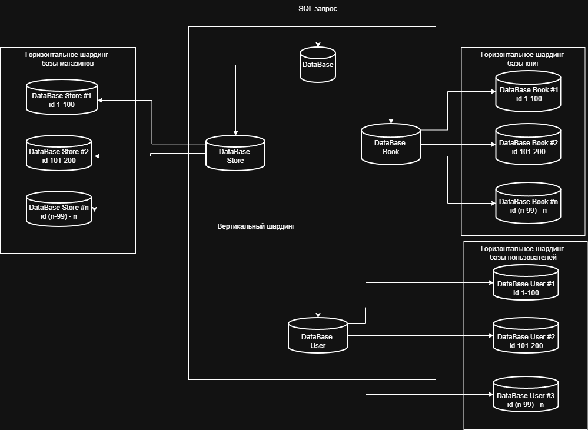

# Домашнее задание к занятию «Репликация и масштабирование. Часть 2» - Зайцев Алексей

### Задание 1

Опишите основные преимущества использования масштабирования методами:

- активный master-сервер и пассивный репликационный slave-сервер;
- master-сервер и несколько slave-серверов;

*Дайте ответ в свободной форме.*

### Выполенение задания 1

1. Активный master-сервер и пассивный репликационный slave-сервер (Active-Passive)
Это схема «горячего резервирования» (Hot Standby).

- Высокая доступность (High Availability): Главное преимущество. Если активный Master выходит из строя, система быстро переключается на пассивный Slave (через Keepalived, ProxySQL или вручную). Время простоя (downtime) сводится к минимуму.

- Безопасность данных: Пассивный Slave постоянно синхронизируется. Если на Master происходит сбой диска или логическая ошибка (например, случайное удаление таблицы), Slave содержит актуальную копию данных.

- Разгрузка бэкапов: Резервное копирование можно делать с пассивного Slave, не нагружая Master и не блокируя таблицы для пользователей.

- Простота: Нет конфликтов записи, так как пишет всегда только один сервер (Master).

2. Master-сервер и несколько slave-серверов (Master-Multiple Slaves)
Это схема для масштабирования чтения (Read Scaling).

- Масштабирование чтения: В большинстве веб-приложений операций чтения (SELECT) в 10-100 раз больше, чем записи. Несколько Slave-серверов позволяют распределить запросы на чтение между ними, снижая нагрузку на Master.

- Географическое распределение: Можно разместить Slave-серверы в разных регионах ближе к пользователям, чтобы снизить задержки (latency) при чтении.

- Отказоустойчивость: Если один из Slave-серверов упадёт, балансировщик нагрузки просто перестанет направлять на него запросы, а остальные продолжат работать.

- Специализация: Один Slave можно отдать под тяжелые аналитические отчеты (OLAP), второй — под обычные пользовательские запросы, а Master оставить только для записи (INSERT/UPDATE).

### Задание 2

Разработайте план для выполнения горизонтального и вертикального шаринга базы данных. База данных состоит из трёх таблиц:

- пользователи,
- книги,
- магазины (столбцы произвольно).

Опишите принципы построения системы и их разграничение или разбивку между базами данных.

*Пришлите блоксхему, где и что будет располагаться. Опишите, в каких режимах будут работать сервера.*

### Выполение задания 2

## Блоксхема 

Для проектирования системы с таблицами пользователи (Users), книги (Books) и магазины (Stores) применена комбинированная стратегия шардинга, представленная на блок-схеме.

1. Принципы построения системы (разбивка между базами данных)

Вертикальный шардинг (разделение по сущностям):
На первом уровне (в центре схемы) база данных разделена на три независимых кластера по функциональному признаку. Это позволяет изолировать нагрузку: тяжелые запросы к каталогу книг не будут замедлять работу с профилями пользователей.

- DataBase Store — выделена под таблицу магазинов (справочные данные).

- DataBase Book — выделена под таблицу книг (самые тяжелые данные по объему текста и изображений).

- DataBase User — выделена под таблицу пользователей (высокая частота операций записи и чтения).

Горизонтальный шардинг (разделение по строкам данных):
На втором уровне каждая из трех вертикальных баз разбита на горизонтальные шарды (куски) по диапазону первичного ключа id:

- Шард 1: id 1-100

- Шард 2: id 101-200

- Шард N: id (n-99) - n

*Такая разбивка позволяет бесконечно масштабировать систему: при росте данных мы просто добавляем новый физический сервер (шард), не перестраивая логику всего приложения.*

2. Режимы работы серверов

Для обеспечения отказоустойчивости и высокой производительности каждая физическая база данных (каждый шард на схеме) работает в режиме Master-Slave (Ведущий-Ведомый):

- Master (Ведущий сервер): Основной сервер в шарде. Принимает все транзакции на изменение данных (INSERT, UPDATE, DELETE).

- Slave (Ведомый сервер): Получает асинхронную реплику данных от своего Master-сервера и находится в режиме "только чтение" (Read-Only).

Зачем это нужно: Все операции чтения (SELECT) направляются на Slave-серверы, что снижает нагрузку на Master. Если Master выйдет из строя, приложение автоматически переключится на Slave, предотвратив простой (High Availability).

Центральный узел DataBase на схеме выступает в роли маршрутизатора (ProxySQL / API Gateway). Он читает SQL-запрос, определяет, к какой вертикальной сущности он относится (Store, Book или User), и перенаправляет его на нужный горизонтальный шард (исходя из id в запросе).

